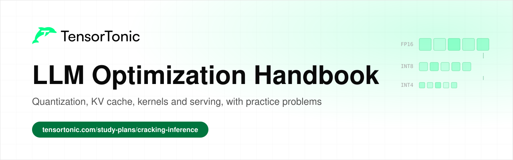
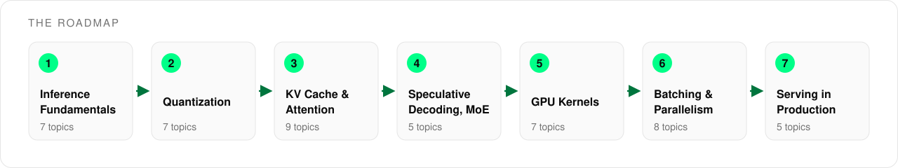

# LLM Optimization Handbook

  

This is a roadmap for making large language models faster, cheaper and smaller to run. It covers 48 topics across seven stages, from how a single request moves through the GPU to running a model in production.

Every topic links to a short explanation and to practice problems where you implement the idea in Python, CUDA or Triton and check your code against tests. Most optimization advice is easy to repeat and hard to apply, and writing the quantizer or the scheduler yourself is the quickest way to see what each technique actually changes.

## Table of Contents

- [Who this is for](#who-this-is-for)
- [How to use this roadmap](#how-to-use-this-roadmap)
- [Stage 1: Inference Fundamentals](#stage-1-inference-fundamentals)
- [Stage 2: Quantization](#stage-2-quantization)
- [Stage 3: KV Cache and Attention](#stage-3-kv-cache-and-attention)
- [Stage 4: Speculative Decoding and MoE](#stage-4-speculative-decoding-and-moe)
- [Stage 5: GPU Kernels](#stage-5-gpu-kernels)
- [Stage 6: Batching and Parallelism](#stage-6-batching-and-parallelism)
- [Stage 7: Serving in Production](#stage-7-serving-in-production)
- [What's next](#whats-next)

## Who this is for

This roadmap is for anyone who wants to understand why LLM inference is slow and what each optimization does about it.

- If you are an **ML engineer moving into inference**, go through the stages in order and do at least one problem per topic.
- If you are **preparing for inference or ML systems interviews**, the first three stages and the batching stage cover most of the questions that come up.
- If you already **serve models in production**, use the tables as a checklist and focus on the topics you have only ever used through a library flag.

You need to be comfortable with Python and know roughly how a transformer works. You do not need prior GPU programming experience until Stage 5.

## How to use this roadmap

Optimization works as a loop. You measure a request, find the bottleneck, apply the technique that targets that bottleneck, and measure again while checking that output quality did not drop. Stage 1 gives you the vocabulary for that loop, and every later stage attacks one of the four bottlenecks it introduces.

For each topic, read the explanation first, then solve one or two of the practice problems. Topics without a practice link are still worth reading, because later topics and real deployments depend on them.

## Stage 1: Inference Fundamentals

A request has two phases. Prefill reads the whole prompt in one parallel pass, and decode produces one token at a time while rereading the weights and the cache on every step. This stage explains why those phases hit different limits and how to measure speed in a way that holds up.

| Topic | Read | Practice |
| --- | --- | --- |
| How a request is served | [What Is an Inference Server?](https://www.tensortonic.com/projects/llm-inference/materials/what-is-an-inference-server) | |
| Attention in the forward pass | [Attention in LLMs](https://www.tensortonic.com/llm-internals/attention-mechanism) | [Causal Masking for Attention](https://www.tensortonic.com/problems/causal-masking), [Scaled Dot-Product Attention](https://www.tensortonic.com/problems/inference-scaled-dot-product-attention) |
| Prefill, decode and the roofline | [What is inference engineering?](https://www.tensortonic.com/guides/inference-engineering) | [Analyze Prefill and Decode with the Roofline Model](https://www.tensortonic.com/problems/inference-prefill-decode-roofline) |
| Model memory and GPU count | [The GPU memory budget](https://www.tensortonic.com/llm-internals/quantization) | [Estimate Model Memory and Minimum GPU Count](https://www.tensortonic.com/problems/inference-model-memory-gpu-count) |
| Token sampling | [How to Build an Inference Server](https://www.tensortonic.com/projects/llm-inference/materials/how-to-build-an-inference-server) | [Temperature, Top-k, and Top-p Sampling](https://www.tensortonic.com/problems/inference-token-sampling) |
| TTFT, TPOT, ITL and throughput | [Latency, throughput, and cost](https://www.tensortonic.com/ml-design/latency) | [Compute TTFT, TPOT, ITL, and Token Throughput](https://www.tensortonic.com/problems/inference-serving-metrics) |
| Latency percentiles | [Latency, throughput, and cost](https://www.tensortonic.com/ml-design/latency) | [Percentiles / Quantiles](https://www.tensortonic.com/problems/percentiles), [Calculate P50, P95, and P99 Inference Latency](https://www.tensortonic.com/problems/inference-latency-percentiles) |

## Stage 2: Quantization

Decode is usually limited by how many bytes it reads per token, so storing weights in fewer bits makes it faster and lets a larger model fit on the same GPU. The work is in choosing scales that keep the error small, since a few large outlier values can ruin a naive scheme.

| Topic | Read | Practice |
| --- | --- | --- |
| Number formats and mixed precision | [Mixed Precision Training: FP16 vs BF16](https://www.tensortonic.com/llm-internals/mixed-precision) | [Mixed-Precision Training Memory Accountant](https://www.tensortonic.com/problems/cs336-l02-training-memory-accountant) |
| Symmetric INT8 quantization | [What is quantization?](https://www.tensortonic.com/llm-internals/quantization) | [Symmetric INT8 Quantization](https://www.tensortonic.com/problems/inference-symmetric-int8-quantization) |
| Per-channel scales | [What is quantization?](https://www.tensortonic.com/llm-internals/quantization) | [Per-Channel Weight Quantization](https://www.tensortonic.com/problems/inference-per-channel-quantization) |
| Group-wise INT4 quantization | [Quantize a Language Model to 4 Bits](https://www.tensortonic.com/projects/quantization-from-scratch) | [Group-Wise INT4 Quantization](https://www.tensortonic.com/problems/inference-groupwise-int4-quantization) |
| FP8 block quantization | [What is quantization?](https://www.tensortonic.com/llm-internals/quantization) | [Block-Wise FP8 Quantization](https://www.tensortonic.com/problems/inference-blockwise-fp8-quantization) |
| Outliers, GPTQ and AWQ | [LLM Quantization Explained: INT8, INT4, GPTQ and AWQ](https://www.tensortonic.com/llm-internals/quantization) | |
| 4-bit fine-tuning with QLoRA | [QLoRA Explained](https://www.tensortonic.com/llm-internals/qlora) | |

## Stage 3: KV Cache and Attention

During decode, the model keeps the keys and values of every previous token so it does not recompute them. That cache often takes more memory than the weights at long context, and most modern attention variants exist to shrink it, store it in blocks or read it with fewer trips to GPU memory.

| Topic | Read | Practice |
| --- | --- | --- |
| The KV cache | [What is the KV cache?](https://www.tensortonic.com/llm-internals/kv-cache) | [Decode Attention with a KV Cache](https://www.tensortonic.com/problems/cs336-l10-kv-cache-decode-step), [Autoregressive Decoding with a KV Cache](https://www.tensortonic.com/problems/inference-autoregressive-kv-cache) |
| Sizing the cache | [KV Cache in LLMs](https://www.tensortonic.com/llm-internals/kv-cache) | [Plan KV-Cache Capacity](https://www.tensortonic.com/problems/cs336-l10-kv-cache-capacity-planner), [Calculate KV Cache Memory for MHA, MQA, GQA, and MLA](https://www.tensortonic.com/problems/inference-kv-cache-memory) |
| Multi-query attention | [Attention in LLMs](https://www.tensortonic.com/llm-internals/attention-mechanism) | [Multi-Query Attention (MQA)](https://www.tensortonic.com/problems/inference-multi-query-attention) |
| Grouped-query attention | [Attention in LLMs](https://www.tensortonic.com/llm-internals/attention-mechanism) | [Causal Grouped-Query Attention](https://www.tensortonic.com/problems/cs336-l03-causal-grouped-query-attention), [Grouped-Query Attention (GQA)](https://www.tensortonic.com/problems/inference-grouped-query-attention) |
| Multi-head latent attention | [KV Cache in LLMs](https://www.tensortonic.com/llm-internals/kv-cache) | [Multi-Head Latent Attention (MLA)](https://www.tensortonic.com/problems/inference-multi-head-latent-attention) |
| RoPE during decoding | [RoPE: Rotary Position Embedding Explained](https://www.tensortonic.com/llm-internals/rope) | [RoPE: Rotary Query and Key Embeddings](https://www.tensortonic.com/problems/cs336-l03-rotary-query-key-embeddings), [Rotary Position Embeddings for Decoding](https://www.tensortonic.com/problems/inference-rotary-position-embeddings) |
| FlashAttention and online softmax | [FlashAttention Explained](https://www.tensortonic.com/llm-internals/flash-attention), [Write FlashAttention Step by Step](https://www.tensortonic.com/projects/flash-attention-from-scratch) | [Blockwise Online Softmax](https://www.tensortonic.com/problems/cs336-l05-blockwise-online-softmax), [FlashAttention with Online Softmax](https://www.tensortonic.com/problems/inference-flash-attention-online-softmax) |
| PagedAttention | [PagedAttention Explained](https://www.tensortonic.com/llm-internals/paged-attention) | [PagedAttention Block Allocation](https://www.tensortonic.com/problems/inference-paged-attention-allocation) |
| Prefix caching | [PagedAttention Explained](https://www.tensortonic.com/llm-internals/paged-attention) | [Find Reusable Prefixes in a KV Trie](https://www.tensortonic.com/problems/cs336-l18-kv-prefix-trie), [Prefix Cache Matching and Reuse](https://www.tensortonic.com/problems/inference-prefix-cache-reuse) |

## Stage 4: Speculative Decoding and MoE

Decode spends most of each step waiting on memory, which leaves spare compute. Speculative decoding uses it to check several drafted tokens in one pass without changing the output distribution, and mixture-of-experts models use sparse routing so each token only runs a small part of a very large model.

| Topic | Read | Practice |
| --- | --- | --- |
| Draft and verify | [Speculative Decoding in LLMs Explained](https://www.tensortonic.com/llm-internals/speculative-decoding) | [Perform Exact Speculative Sampling](https://www.tensortonic.com/problems/cs336-l10-speculative-sampling), [Speculative Decoding and Token Verification](https://www.tensortonic.com/problems/inference-speculative-decoding-verification) |
| Acceptance rate and real speedup | [Speculative Decoding in LLMs Explained](https://www.tensortonic.com/llm-internals/speculative-decoding) | |
| Draft-free variants such as Medusa and EAGLE | [Speculative Decoding in LLMs Explained](https://www.tensortonic.com/llm-internals/speculative-decoding) | |
| Top-k expert routing | [Mixture of Experts (MoE) in LLMs Explained](https://www.tensortonic.com/llm-internals/mixture-of-experts) | [Top-k MoE Router with Load Statistics](https://www.tensortonic.com/problems/cs336-l04-topk-moe-router), [Sparse MoE Top-k Expert Routing](https://www.tensortonic.com/problems/inference-moe-top-k-routing) |
| Token dispatch and aggregation | [Mixture of Experts (MoE) in LLMs Explained](https://www.tensortonic.com/llm-internals/mixture-of-experts) | [MoE Token Dispatch and Expert Aggregation](https://www.tensortonic.com/problems/inference-moe-dispatch-aggregation) |

## Stage 5: GPU Kernels

Every technique above eventually runs as a GPU kernel, and fused kernels are where many of the real gains come from. The goal of this stage is to load data from GPU memory once, reuse it from fast on-chip memory and write the result once, first in CUDA and then in Triton.

| Topic | Read | Practice |
| --- | --- | --- |
| Threads, blocks and warps | [How to Learn CUDA](https://www.tensortonic.com/guides/how-to-learn-cuda) | [Vector Addition as a CUDA Kernel](https://www.tensortonic.com/problems/vector-addition), [GPU Occupancy Calculator](https://www.tensortonic.com/problems/cs336-l05-gpu-occupancy-calculator) |
| Memory coalescing and shared memory | [How to Learn CUDA](https://www.tensortonic.com/guides/how-to-learn-cuda) | [Global-Memory Coalescing Counter](https://www.tensortonic.com/problems/cs336-l05-global-memory-coalescing), [Shared-Memory Bank Conflict Analyzer](https://www.tensortonic.com/problems/cs336-l05-shared-memory-bank-conflicts) |
| Tiled matrix multiplication | [CUDA study plan](https://www.tensortonic.com/study-plans/cuda-basics) | [Tiled Matrix Multiplication as a CUDA Kernel](https://www.tensortonic.com/problems/tiled-matmul) |
| Reductions and softmax | [CUDA study plan](https://www.tensortonic.com/study-plans/cuda-basics) | [Softmax as a CUDA Kernel](https://www.tensortonic.com/problems/softmax), [Online Softmax Kernel in Triton](https://www.tensortonic.com/problems/triton-online-softmax) |
| Writing kernels in Triton | [Triton study plan](https://www.tensortonic.com/study-plans/triton-basics) | [Vector Addition in Triton](https://www.tensortonic.com/problems/triton-vector-addition), [Tiled Matrix Multiplication in Triton](https://www.tensortonic.com/problems/triton-matmul) |
| Kernel fusion | [Triton study plan](https://www.tensortonic.com/study-plans/triton-basics) | [Fused Matmul + Bias + ReLU in Triton](https://www.tensortonic.com/problems/triton-fused-matmul-bias-relu), [RMSNorm Forward in Triton](https://www.tensortonic.com/problems/triton-rmsnorm) |
| Attention kernels | [Write FlashAttention Step by Step](https://www.tensortonic.com/projects/flash-attention-from-scratch) | [FlashAttention Forward Kernel in Triton](https://www.tensortonic.com/problems/triton-flash-attention-fwd), [KV Cache Append in Triton](https://www.tensortonic.com/problems/triton-kv-append) |

## Stage 6: Batching and Parallelism

A single request leaves most of the GPU idle, so a server earns its throughput by scheduling many requests together. This stage covers how batches are formed and reshaped every step, and how a model is split across GPUs when it no longer fits on one.

| Topic | Read | Practice |
| --- | --- | --- |
| Dynamic batching | [How to Build an Inference Server](https://www.tensortonic.com/projects/llm-inference/materials/how-to-build-an-inference-server) | [Dynamic Request Batching](https://www.tensortonic.com/problems/inference-dynamic-batching) |
| Continuous batching | [PagedAttention Explained](https://www.tensortonic.com/llm-internals/paged-attention) | [Simulate Continuous Decode Batching](https://www.tensortonic.com/problems/cs336-l18-continuous-batching-scheduler), [Simulate Continuous Batching](https://www.tensortonic.com/problems/inference-continuous-batching) |
| Chunked prefill | [What is inference engineering?](https://www.tensortonic.com/guides/inference-engineering) | [Simulate Chunked Prefill Scheduling](https://www.tensortonic.com/problems/inference-chunked-prefill-scheduling) |
| Prefill and decode disaggregation | [What is inference engineering?](https://www.tensortonic.com/guides/inference-engineering) | [Simulate Disaggregated Prefill and Decode Serving](https://www.tensortonic.com/problems/inference-disaggregated-prefill-decode) |
| Cache-aware request routing | [LLM serving and RAG](https://www.tensortonic.com/ml-design/llm-serving) | [Route Cache-Aware Prefill Requests](https://www.tensortonic.com/problems/cs336-l18-cache-aware-prefill-routing) |
| Collective communication | | [Calculate Collective Effective Bandwidth](https://www.tensortonic.com/problems/cs336-l07-collective-bandwidth), [Simulate Distributed Collectives](https://www.tensortonic.com/problems/cs336-l07-simulate-collectives) |
| Tensor parallelism | | [Reconstruct a Column-Parallel MLP Layer](https://www.tensortonic.com/problems/cs336-l07-column-parallel-mlp), [Calculate Tensor Parallel Communication Cost](https://www.tensortonic.com/problems/inference-tensor-parallel-communication) |
| Expert parallelism | [Mixture of Experts (MoE) in LLMs Explained](https://www.tensortonic.com/llm-internals/mixture-of-experts) | [Expert Parallel Routing Across GPUs](https://www.tensortonic.com/problems/inference-expert-parallel-routing) |

## Stage 7: Serving in Production

A fast model only helps if the whole system stays fast under real traffic. This stage is about building and benchmarking the server, finding where GPU time goes, and turning throughput at your latency target into a cost you can plan around.

| Topic | Read | Practice |
| --- | --- | --- |
| Building an inference server | [Build an LLM Inference Server From Scratch](https://www.tensortonic.com/projects/llm-inference) | |
| Benchmarking method | [Latency, throughput, and cost](https://www.tensortonic.com/ml-design/latency) | |
| Profiling GPU time | [What is inference engineering?](https://www.tensortonic.com/guides/inference-engineering) | [Measure Kernel Timeline Utilization](https://www.tensortonic.com/problems/cs336-l18-kernel-timeline-utilization) |
| Throughput and cost under a latency target | [Latency, throughput, and cost](https://www.tensortonic.com/ml-design/latency) | [Optimize Throughput and Cost Under a Latency SLO](https://www.tensortonic.com/problems/inference-throughput-cost-slo) |
| Rollouts and monitoring | [Fallbacks and model rollouts](https://www.tensortonic.com/ml-design/fallbacks) | |

## What's next

Once the stages above feel familiar, the [Cracking Inference study plan](https://www.tensortonic.com/study-plans/cracking-inference) collects the inference problems from this roadmap in one place, and the [LLM Internals](https://www.tensortonic.com/llm-internals) pages explain each mechanism visually. To put the pieces together, [build an inference server](https://www.tensortonic.com/projects/llm-inference) or [quantize a language model to 4 bits](https://www.tensortonic.com/projects/quantization-from-scratch) end to end.

These optimizations are easier to reason about once you have written the model they speed up, and the [How to Build an LLM from Scratch](https://www.tensortonic.com/guides/build-an-llm-from-scratch) guide walks through building a small one stage by stage.

If you want to write the fused kernels from Stage 5 yourself, the [How to Learn Triton](https://www.tensortonic.com/guides/how-to-learn-triton) guide explains how to learn Triton step by step.

## License

MIT
