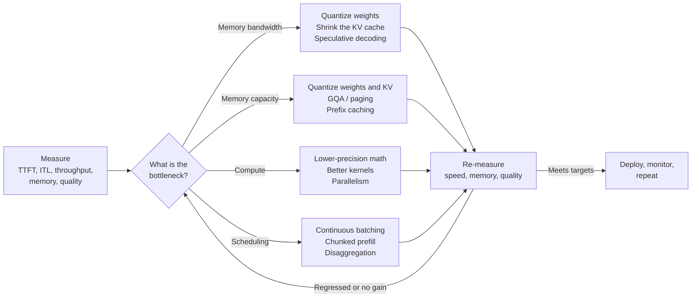

<div align="center">

# LLM Optimization Handbook

**Make LLMs faster, cheaper, and smaller.**

🧪 [Practice on TensorTonic](https://www.tensortonic.com/study-plans/cracking-inference) •
⚡ [Inference Engineering](https://www.tensortonic.com/study-plans/cracking-inference) •
🖥️ [CUDA Kernels](https://www.tensortonic.com/study-plans/cuda-basics) •
🔺 [Triton Kernels](https://www.tensortonic.com/study-plans/triton-basics) •
📖 [LLM Internals](https://www.tensortonic.com/llm-internals/kv-cache)

</div>

This handbook takes you from *why LLM inference is slow* to *measuring and shipping an optimized deployment*, with worked formulas, code you can adapt, and a curated list of primary sources. Every topic ends with hands-on problems on [TensorTonic](https://www.tensortonic.com/), where you implement the idea yourself and run it against tests.

The handbook is divided into three parts:

1. 🧩 **Inference Fundamentals** covers how generation works, where the bottlenecks are, and how to measure them.
2. ⚡ **The Optimizer** focuses on making the model itself cheaper to run: quantization, KV cache and attention, speculative decoding and GPU kernels.
3. 🚀 **The Serving Engineer** focuses on running it in production: batching and scheduling, inference engines, benchmarking, profiling, cost and deployment.

> [!NOTE]
> **Every number is labeled.** **Computed** = deterministic arithmetic from the formulas on this page and vendor datasheet peaks. **Cited** = reported by a named source under its conditions. **Illustrative** = invented to explain an idea, never evidence. The handbook makes **no unmeasured speedup claims**: where a benefit depends on hardware, load or model, it says so and tells you how to measure it.

## Contents

- **🧩 Inference Fundamentals**: [1. How LLM inference works](#1-how-llm-inference-works) · [2. Measuring performance](#2-measuring-performance)
- **⚡ The Optimizer**: [3. Quantization](#3-quantization) · [4. KV cache and efficient attention](#4-kv-cache-and-efficient-attention) · [5. Speculative decoding](#5-speculative-decoding) · [6. GPU programming: CUDA and Triton](#6-gpu-programming-cuda-and-triton)
- **🚀 The Serving Engineer**: [7. Batching and scheduling](#7-batching-and-scheduling) · [8. Inference engines](#8-inference-engines) · [9. Benchmarking and profiling](#9-benchmarking-and-profiling) · [10. Cost and production](#10-cost-and-production)

## 🗺️ The Optimization Loop

Optimization is a loop, not a checklist: measure, find the bottleneck, apply the lever that attacks *that* bottleneck, re-measure, and confirm quality did not regress.



---

## 🧩 Inference Fundamentals

This part introduces what you need before optimizing anything: what a request does on the GPU, what limits it, and how to tell.

### 1. How LLM inference works

An autoregressive model generates one token at a time. A request has two phases, and they stress different hardware resources.

- **Prefill**: processes the whole prompt in one parallel pass and builds the KV cache. It is usually compute-bound and determines time to first token (TTFT).
- **Decode**: produces one token per pass. Every pass reads all weights plus the whole KV cache, so it is usually memory-bandwidth-bound and determines time per output token (TPOT).
- **Roofline model**: an operation is memory-bound if its FLOPs per byte are below the GPU's ratio of peak FLOPs to peak bandwidth (about 295 for an H100 SXM, **Computed** from datasheet peaks). Batch-1 FP16 decode does about 1 FLOP per byte, so the arithmetic units mostly wait.
- **The four bottlenecks**: compute, memory bandwidth, memory capacity and scheduling. Every technique in this handbook attacks one of them.

```
kv_bytes_per_token = 2 × layers × kv_heads × head_dim × bytes_per_element
t_step ≥ max( (weight_bytes + B × kv_bytes_per_seq) / bandwidth ,  2·params·B / peak_FLOPs )
```

**Computed** roofline for Llama-3 8B with 2,048 cached tokens per sequence, from vendor datasheet peaks. These are *upper bounds*, not measurements:

| GPU | Weights | Batch 1 (per user) | Batch 16 (total) | Batch 64 (total) |
| --- | --- | --- | --- | --- |
| H100 SXM | FP16 | 205 tok/s | 2,633 tok/s | 6,450 tok/s |
| H100 SXM | INT4 (weight-only) | 782 tok/s | 6,450 tok/s | 10,116 tok/s |
| A100 80 GB | FP16 | 125 tok/s | 1,603 tok/s | 3,926 tok/s |
| A100 80 GB | INT4 (weight-only) | 476 tok/s | 3,926 tok/s | 6,157 tok/s |

INT4 does not give 4× even in the ideal model, because the KV-cache bytes did not shrink. Real systems land below these numbers; the gap is what profiling and kernel work are for.

📚 **References**:
- *LLM Inference Performance Engineering: Best Practices* by Databricks: a practitioner's account of memory-bound decode and the metrics that matter. Practice: [Compute TTFT, TPOT, ITL, and Token Throughput](https://www.tensortonic.com/problems/inference-serving-metrics).
- *Efficiently Scaling Transformer Inference* by Pope et al.: an analytical treatment of memory and latency in large-model serving. Practice: [Estimate Model Memory and Minimum GPU Count](https://www.tensortonic.com/problems/inference-model-memory-gpu-count).
- *Roofline: an insightful visual performance model* by Williams, Waterman and Patterson: the original roofline paper. Practice: [Analyze Prefill and Decode with the Roofline Model](https://www.tensortonic.com/problems/inference-prefill-decode-roofline).
- *Attention Is All You Need* by Vaswani et al.: the Transformer architecture. Explainer: [The attention mechanism](https://www.tensortonic.com/llm-internals/attention-mechanism).

🧪 **Practice on TensorTonic**: [Analyze Prefill and Decode with the Roofline Model](https://www.tensortonic.com/problems/inference-prefill-decode-roofline) and [Estimate Model Memory and Minimum GPU Count](https://www.tensortonic.com/problems/inference-model-memory-gpu-count).

### 2. Measuring performance

You cannot optimize what you cannot measure, and most published numbers are not comparable because their conditions are missing.

- **TTFT**: from request sent to first token received, including queueing and prefill.
- **ITL and TPOT**: ITL is the gap between consecutive tokens, which exposes stalls; TPOT is `(E2E − TTFT) / (output tokens − 1)` per request, which gives the average speed.
- **Throughput and goodput**: output tokens per second over the whole run, and the subset of requests that met your latency targets. Report the latency/throughput *curve* across concurrency, not a single point.
- **Percentiles, not means**: p50, p95 and p99, because a good mean hides a bad tail.
- **Conditions**: model and revision, precision, GPU, engine and version, workload lengths, concurrency, warmup and sampling. A number without them is not a result.

A common pitfall: some HTTP clients buffer streamed events, which silently distorts TTFT and ITL. Check that your benchmark client reads tokens as they arrive.

📚 **References**:
- *Benchmark CLI* by vLLM: the metric definitions used here, and `vllm bench serve`. Practice: [Compute TTFT, TPOT, ITL, and Token Throughput](https://www.tensortonic.com/problems/inference-serving-metrics).
- *DistServe* by Zhong et al.: introduces goodput as the serving objective. Practice: [Simulate Disaggregated Prefill and Decode Serving](https://www.tensortonic.com/problems/inference-disaggregated-prefill-decode).

🧪 **Practice on TensorTonic**: [Compute TTFT, TPOT, ITL, and Token Throughput](https://www.tensortonic.com/problems/inference-serving-metrics) and [Calculate P50, P95, and P99 Inference Latency](https://www.tensortonic.com/problems/inference-latency-percentiles).

---

## ⚡ The Optimizer

This part focuses on making the model itself cheaper to run.

### 3. Quantization

Quantization stores numbers in fewer bits: `q = round(w / scale)`, recovered as `q × scale`. The error per weight is at most `scale / 2`, so the craft is choosing scales. Because decode is memory-bound, moving fewer weight bytes is often the biggest single lever.

- **Formats**: BF16/FP16 use 2 bytes per parameter, FP8 and INT8 use 1, and INT4 uses 0.5. Weights for Llama-3 8B take 15.0 GiB in FP16, 7.5 in INT8 and 3.7 in INT4 (**Computed**, approximate parameter count, ignoring scales).
- **Scale granularity**: per-tensor, per-channel, or per-group (commonly 128). Finer scales buy accuracy for a few percent more storage.
- **Outliers**: a few activation channels in large models are far larger than the rest and wreck naive scales. **LLM.int8()** keeps them in higher precision; **SmoothQuant** shifts the difficulty into the weights.
- **GPTQ and AWQ**: post-training methods that use a small calibration set. GPTQ compensates rounding error layer by layer with second-order information; AWQ protects the weight channels that multiply large activations.
- **GGUF and llama.cpp**: a single-file format for CPU, Apple Silicon and consumer-GPU inference.
- **Weight-only vs weight+activation**: W4A16 saves bytes but the math still runs at 16-bit, so it helps memory-bound decode far more than compute-bound prefill. W8A8 and FP8 also use low-precision tensor cores.
- **Evaluate honestly**: perplexity plus task benchmarks plus your own prompts, always against the same model at higher precision.

<details>
<summary><b>Which format should I use?</b></summary>

| Situation | Starting point | Why |
| --- | --- | --- |
| Memory-bound GPU serving, model barely fits | Weight-only INT4 (AWQ or GPTQ) | Cuts weight bytes and bandwidth |
| Compute-heavy serving on recent NVIDIA GPUs | FP8 or W8A8 | Uses low-precision tensor cores |
| CPU, Apple Silicon, consumer GPU | GGUF with llama.cpp | Built for local inference |
| Fine-tuning on a small GPU | NF4 base + LoRA (QLoRA) | Memory-efficient training |

</details>

📚 **References**:
- *LLM.int8()* by Dettmers et al.: outlier-aware 8-bit matrix multiplication. Practice: [Implement Symmetric INT8 Quantization](https://www.tensortonic.com/problems/inference-symmetric-int8-quantization).
- *SmoothQuant* by Xiao et al.: migrates quantization difficulty from activations to weights for W8A8. Practice: [Implement Per-Channel Weight Quantization](https://www.tensortonic.com/problems/inference-per-channel-quantization).
- *GPTQ* by Frantar et al.: layer-wise post-training quantization with second-order updates. Practice: [Implement Group-Wise INT4 Quantization](https://www.tensortonic.com/problems/inference-groupwise-int4-quantization).
- *AWQ* by Lin et al.: activation-aware weight-only quantization. Practice: [Implement Group-Wise INT4 Quantization](https://www.tensortonic.com/problems/inference-groupwise-int4-quantization).
- *QLoRA* by Dettmers et al.: introduces the NF4 data type for memory-efficient fine-tuning. Explainer: [Quantization in LLMs](https://www.tensortonic.com/llm-internals/quantization).
- *llama.cpp* and the GGUF specification: the local-inference format and its engine. Explainer: [Quantization in LLMs](https://www.tensortonic.com/llm-internals/quantization).

🧪 **Practice on TensorTonic**: [Symmetric INT8](https://www.tensortonic.com/problems/inference-symmetric-int8-quantization), [Per-Channel](https://www.tensortonic.com/problems/inference-per-channel-quantization), [Group-Wise INT4](https://www.tensortonic.com/problems/inference-groupwise-int4-quantization) and [Block-Wise FP8](https://www.tensortonic.com/problems/inference-blockwise-fp8-quantization). Explainer: [Quantization in LLMs](https://www.tensortonic.com/llm-internals/quantization).

### 4. KV cache and efficient attention

The KV cache stores each token's keys and values so they are computed once. It removes redundant computation but costs memory, and every decode step must read all of it. At high concurrency or long context it, not the weights, becomes the limit.

- **Sizing**: use the formula in topic 1, because the architecture decides the cost (**Computed**, FP16, per token): Llama-2 7B with 32 KV heads needs 512 KiB per token (16 GiB at 32k tokens), while Llama-3 8B with 8 KV heads needs 128 KiB (4 GiB at 32k).
- **MQA, GQA and MLA**: share K/V across query heads, or compress them into a latent, to shrink the cache. These are decided at training time, so you cannot switch a deployed MHA checkpoint for free.
- **PagedAttention**: stores the cache in fixed-size blocks with a block table, so memory is allocated on demand, fragmentation disappears and prefixes can be shared. It is the memory manager behind vLLM.
- **Prefix caching**: reuses cached blocks for shared prompts. It helps when prefixes repeat and does nothing otherwise, which matters when benchmarking.
- **KV quantization**: 8-bit K/V halves the cache. Validate quality on long-context tasks.
- **FlashAttention**: computes the *same* attention without ever writing the score matrix to GPU main memory, by tiling and keeping a running softmax:

```
m' = max(m, max_j s_j);   a = exp(m − m')
l' = a·l + Σ exp(s_j − m');   u' = a·u + Σ exp(s_j − m')·v_j;   out = u / l
```

It reduces memory traffic; it does not make dense attention linear-time, and decode needs different kernels because the workload shape differs. In PyTorch, the fused path is one call away:

```python
import torch.nn.functional as F
out = F.scaled_dot_product_attention(q, k, v, dropout_p=0.0, is_causal=True)  # may dispatch to a fused kernel
```

Which kernel actually ran depends on device, dtype, masks and shapes, so check with the profiler.

📚 **References**:
- *Fast Transformer Decoding: One Write-Head is All You Need* by Shazeer: multi-query attention. Practice: [Implement Multi-Query Attention (MQA)](https://www.tensortonic.com/problems/inference-multi-query-attention).
- *GQA* by Ainslie et al.: grouped-query attention and uptraining from MHA checkpoints. Practice: [Implement Grouped-Query Attention (GQA)](https://www.tensortonic.com/problems/inference-grouped-query-attention).
- *DeepSeek-V2* by DeepSeek-AI: introduces multi-head latent attention. Practice: [Implement Multi-Head Latent Attention (MLA)](https://www.tensortonic.com/problems/inference-multi-head-latent-attention).
- *PagedAttention* by Kwon et al.: the paper behind vLLM, which reports 2-4× throughput over the compared systems under its own conditions (**Cited**). Explainer: [PagedAttention](https://www.tensortonic.com/llm-internals/paged-attention).
- *FlashAttention* and *FlashAttention-2* by Dao et al.: IO-aware exact attention. Explainer: [FlashAttention](https://www.tensortonic.com/llm-internals/flash-attention).
- *scaled_dot_product_attention* by PyTorch: the API that dispatches to fused kernels. Practice: [Implement Scaled Dot-Product Attention](https://www.tensortonic.com/problems/inference-scaled-dot-product-attention).
- *Fused attention tutorial* by Triton: the running max, denominator and accumulator in a GPU kernel. Practice: [FlashAttention Forward in Triton](https://www.tensortonic.com/problems/triton-flash-attention-fwd).

🧪 **Practice on TensorTonic**: [KV Cache Memory for MHA/MQA/GQA/MLA](https://www.tensortonic.com/problems/inference-kv-cache-memory), [GQA](https://www.tensortonic.com/problems/inference-grouped-query-attention), [PagedAttention Block Allocation](https://www.tensortonic.com/problems/inference-paged-attention-allocation), [Prefix Cache Reuse](https://www.tensortonic.com/problems/inference-prefix-cache-reuse) and [FlashAttention with Online Softmax](https://www.tensortonic.com/problems/inference-flash-attention-online-softmax). Explainers: [KV Cache](https://www.tensortonic.com/llm-internals/kv-cache) and [FlashAttention](https://www.tensortonic.com/llm-internals/flash-attention).

### 5. Speculative decoding

Decode is slow because each token needs a full pass of the large model, but verifying several proposed tokens in one pass costs little more than generating one, because the pass is memory-bound.

- **The algorithm**: a cheap draft proposes `γ` tokens; the target scores them all in one pass; tokens are accepted left to right with probability `min(1, p/q)`; the first rejection is replaced by a sample from `norm(max(0, p − q))`; and if all pass, one bonus token is sampled.
- **It is exact**: the output distribution equals the target's own, because the probability of emitting `x` is `min(p, q) + max(0, p − q) = p`.
- **Tokens per round**: `E[N] = (1 − α^(γ+1)) / (1 − α)` for average acceptance `α`, so α = 0.85 and γ = 4 give 3.709 tokens per round (**Computed**).
- **Tokens per round is not speedup**: wall-clock gain also depends on draft cost and verification cost. It tends to help at low batch size with a well-matched draft, and can hurt on a heavily loaded server with no spare compute, so measure TPOT and goodput on your own traffic.
- **Variants**: a separate draft model, prompt or n-gram lookup, Medusa heads, EAGLE, and tree-based verification.

📚 **References**:
- *Fast Inference from Transformers via Speculative Decoding* by Leviathan, Kalman and Matias: the algorithm and the idealized speedup model. Practice: [Implement Speculative Decoding and Token Verification](https://www.tensortonic.com/problems/inference-speculative-decoding-verification).
- *Accelerating LLM Decoding with Speculative Sampling* by Chen et al.: the independent, concurrent formulation.
- *Medusa* by Cai et al.: multiple decoding heads instead of a draft model.
- *EAGLE* by Li et al.: drafting at the feature level.
- *SpecInfer* by Miao et al.: tree-based speculation and verification.

🧪 **Practice on TensorTonic**: [Speculative Decoding and Token Verification](https://www.tensortonic.com/problems/inference-speculative-decoding-verification). Explainer: [Speculative Decoding](https://www.tensortonic.com/llm-internals/speculative-decoding).

### 6. GPU programming: CUDA and Triton

Most LLM kernels are limited by memory traffic, so the core skills are **fusion**, doing several steps per trip to memory, and **tiling**, reusing data from fast memory. Use existing kernels where you can, and write your own for a *profiled* hotspot that nothing covers.

- **Execution model**: threads form blocks, which share fast memory and synchronize, and warps of 32 that run in lockstep; blocks run on streaming multiprocessors.
- **Memory hierarchy**: registers, shared memory, L2 and HBM. Load from HBM once, reuse from fast memory, and write once.
- **Coalescing and occupancy**: consecutive threads should touch consecutive addresses, and you need enough resident warps to hide latency.
- **CUDA**: one thread per element, with explicit indexing, grids and shared memory.
- **Triton**: you program a *block* of data in Python and the compiler handles thread mapping and shared memory, which makes fused LLM kernels productive to write.
- **Correctness habit**: every kernel ships with a reference check against a trusted implementation, with deliberate tolerances and ragged sizes.

```python
@triton.jit
def add_kernel(x_ptr, y_ptr, out_ptr, n_elements, BLOCK_SIZE: tl.constexpr):
    pid = tl.program_id(axis=0)
    offsets = pid * BLOCK_SIZE + tl.arange(0, BLOCK_SIZE)
    mask = offsets < n_elements
    tl.store(out_ptr + offsets,
             tl.load(x_ptr + offsets, mask=mask) + tl.load(y_ptr + offsets, mask=mask),
             mask=mask)
```

A memory-bound kernel like this one should approach your GPU's peak bandwidth, so measure its GB/s as well as checking its output.

📚 **References**:
- *CUDA C++ Programming Guide* and *Best Practices Guide* by NVIDIA: the execution model and memory optimization. Practice: [CUDA Kernels study plan](https://www.tensortonic.com/study-plans/cuda-basics).
- *Triton tutorials*: from vector add to fused attention. Practice: [Triton Kernels study plan](https://www.tensortonic.com/study-plans/triton-basics).
- *Triton: an intermediate language and compiler for tiled neural network computations* by Tillet, Kung and Cox: the original paper.

🧪 **Practice on TensorTonic**: write kernels and run them against correctness tests on real GPU hardware with the [CUDA Kernels](https://www.tensortonic.com/study-plans/cuda-basics) (35 problems) and [Triton Kernels](https://www.tensortonic.com/study-plans/triton-basics) (30 problems) study plans. LLM-relevant Triton problems: [Fused Softmax](https://www.tensortonic.com/problems/triton-fused-softmax), [RMSNorm](https://www.tensortonic.com/problems/triton-rmsnorm), [RoPE](https://www.tensortonic.com/problems/triton-rope), [KV Cache Append](https://www.tensortonic.com/problems/triton-kv-append) and [FlashAttention Forward](https://www.tensortonic.com/problems/triton-flash-attention-fwd). For an ordered path through all 35 CUDA problems, see the [CUDA practice guide](https://www.tensortonic.com/guides/cuda-practice-problems).

---

## 🚀 The Serving Engineer

This part focuses on running optimized models reliably in production.

### 7. Batching and scheduling

Because decode is memory-bound, serving many sequences together is nearly free: the weights are read once per step for the whole batch. The question is how to form the batch.

- **Static batching**: runs a fixed batch until *every* request finishes, so early finishers leave idle slots.
- **Continuous batching**: re-forms the batch every decode step, so finished requests leave and waiting ones join immediately. It needs flexible KV memory, hence PagedAttention.
- **Chunked prefill**: splits long prompts into chunks scheduled alongside decode tokens, trading some TTFT for smoother ITL.
- **Prefill/decode disaggregation**: runs the two phases on separate GPU pools, each tuned to its own bottleneck, at the cost of transferring KV caches.

📚 **References**:
- *Orca* by Yu et al.: iteration-level scheduling, or continuous batching. Practice: [Simulate Continuous Batching](https://www.tensortonic.com/problems/inference-continuous-batching).
- *Sarathi-Serve* by Agrawal et al.: chunked prefill and the throughput-latency trade-off. Practice: [Simulate Chunked Prefill Scheduling](https://www.tensortonic.com/problems/inference-chunked-prefill-scheduling).
- *DistServe* by Zhong et al. and *Splitwise* by Patel et al.: prefill/decode disaggregation. Practice: [Simulate Disaggregated Prefill and Decode Serving](https://www.tensortonic.com/problems/inference-disaggregated-prefill-decode).

🧪 **Practice on TensorTonic**: [Dynamic Request Batching](https://www.tensortonic.com/problems/inference-dynamic-batching), [Simulate Continuous Batching](https://www.tensortonic.com/problems/inference-continuous-batching), [Chunked Prefill](https://www.tensortonic.com/problems/inference-chunked-prefill-scheduling) and [Disaggregated Prefill and Decode](https://www.tensortonic.com/problems/inference-disaggregated-prefill-decode).

### 8. Inference engines

You will almost always use an engine rather than write a scheduler, and the major options all implement continuous batching and paged KV caches.

- **vLLM**: an open-source engine built around PagedAttention, with an OpenAI-compatible server, and the fastest path to a working deployment across many models and hardware.
- **TensorRT-LLM**: NVIDIA's library for NVIDIA GPUs, with in-flight batching, paged attention and FP8/FP4 on supporting architectures, offering more NVIDIA-specific tuning potential.
- **llama.cpp**: CPU, Apple Silicon and consumer-GPU inference with GGUF.
- **Choosing**: depends on model, hardware, workload and latency targets, so benchmark candidates on your workload with the same harness and conditions. Flags for quantization, speculation and parallelism change between releases, so use the docs for the version you install.

```bash
vllm serve meta-llama/Llama-3.1-8B-Instruct
vllm bench serve --backend vllm --model meta-llama/Llama-3.1-8B-Instruct \
    --num-prompts 100 --percentile-metrics ttft,tpot,itl,e2el
```

📚 **References**: the *vLLM documentation* (serving, quantization, speculative decoding and benchmarking), the *TensorRT-LLM overview* by NVIDIA (features and supported architectures), and *llama.cpp* (local inference). To build the underlying mechanisms yourself, work through the [Inference Engineering study plan](https://www.tensortonic.com/study-plans/cracking-inference).

### 9. Benchmarking and profiling

Benchmarks tell you *how fast* a system is; profilers tell you *why*.

- **Method**: warm up and discard the first runs, use a realistic workload, know whether your load is closed-loop or open-loop, control prefix-cache contamination, repeat and report variance, compare like with like, and check quality alongside speed.
- **Memory**: `torch.cuda.max_memory_allocated()` gives peak tensor memory, and `nvidia-smi` gives the driver's view. Engines such as vLLM pre-allocate, so device memory mostly reflects configuration, not workload.
- **Profiling**: find which kernels dominate GPU time, whether the GPU idles between kernels, and whether an operation is memory- or compute-bound against the roofline.
- **Sanity check**: a measurement *above* the roofline bound means a wrong assumption or a bug.

```python
from torch.profiler import profile, ProfilerActivity

with profile(activities=[ProfilerActivity.CPU, ProfilerActivity.CUDA]) as prof:
    model.generate(**inputs, max_new_tokens=32)
print(prof.key_averages().table(sort_by="cuda_time_total", row_limit=15))
```

📚 **References**: the *Profiler API* and *CUDA memory semantics* by PyTorch (kernel-level timing and peak memory), and *Nsight Systems* by NVIDIA (a system-wide timeline of CPU threads, kernels and copies). Practice: [Calculate P50, P95, and P99 Inference Latency](https://www.tensortonic.com/problems/inference-latency-percentiles) and the [CUDA Performance quiz](https://www.tensortonic.com/study-plans/cuda-basics/quiz/cuda-performance).

### 10. Cost and production

Cost is arithmetic you control, but only if its inputs are trustworthy:

```
cost per 1M output tokens = (GPU $/hour × GPUs) / (output tokens/s × 3600) × 1,000,000
```

- **The price is your input**: on-demand, reserved, spot and amortized prices differ hugely, which is why this handbook ships no price table.
- **Use throughput at your latency target**, not peak throughput, and prefer goodput.
- **Include utilization**: cost per *served* token, not per *possible* token.
- **Before rollout**: latency targets as percentiles, capacity at those targets, a quality regression suite, memory headroom at maximum context times concurrency, overload behavior, and pinned engine and model versions.
- **In production**: export TTFT/ITL percentiles, queue depth, KV-cache utilization and preemption rate; autoscale on queue depth or latency; canary every change in model, quantization, engine or decoding settings; and keep a tested rollback.

🧪 **Practice on TensorTonic**: [Optimize Throughput and Cost Under a Latency SLO](https://www.tensortonic.com/problems/inference-throughput-cost-slo).

---

## 🧪 Practice on TensorTonic

Reading builds understanding; implementing from scratch builds skill. [TensorTonic](https://www.tensortonic.com/) is a hands-on platform where you write these algorithms in the browser and run them against tests. Four resources line up with this handbook:

| Resource | Covers | Pairs with |
| --- | --- | --- |
| [Inference Engineering](https://www.tensortonic.com/study-plans/cracking-inference) (30 problems: 5 easy, 13 medium, 12 hard) | Attention variants, KV cache, quantization, batching and serving metrics, distributed inference | Topics 1-5, 7, 10 |
| [CUDA Kernels](https://www.tensortonic.com/study-plans/cuda-basics) (35 problems) | Vector ops to tiled matrix multiplication, on real GPUs | Topic 6 |
| [Triton Kernels](https://www.tensortonic.com/study-plans/triton-basics) (30 problems) | Block model to FlashAttention forward, checked against PyTorch references | Topics 4, 6 |
| [LLM Internals](https://www.tensortonic.com/llm-internals/kv-cache) | Interactive explainers on the [KV Cache](https://www.tensortonic.com/llm-internals/kv-cache), [FlashAttention](https://www.tensortonic.com/llm-internals/flash-attention), [Quantization](https://www.tensortonic.com/llm-internals/quantization) and [Speculative Decoding](https://www.tensortonic.com/llm-internals/speculative-decoding) | Topics 3-5 |

**Suggested loop:** read a topic here, implement the same idea on TensorTonic, then come back to the references to go deeper. The CUDA and Triton plans run on real GPU hardware, so you can learn kernels without owning a GPU. Some problems are part of TensorTonic Pro; see [pricing](https://www.tensortonic.com/pricing) for what is included on each plan.

## 🤝 Contributing

Contributions are welcome, especially corrections, clearer explanations and measured results with full conditions. The one rule: every claim needs a source or a reproducible calculation, and every number needs its label. Open an issue or a pull request.

## License

Maintained by [TensorTonic](https://www.tensortonic.com/). Licensed under the [MIT License](LICENSE).
